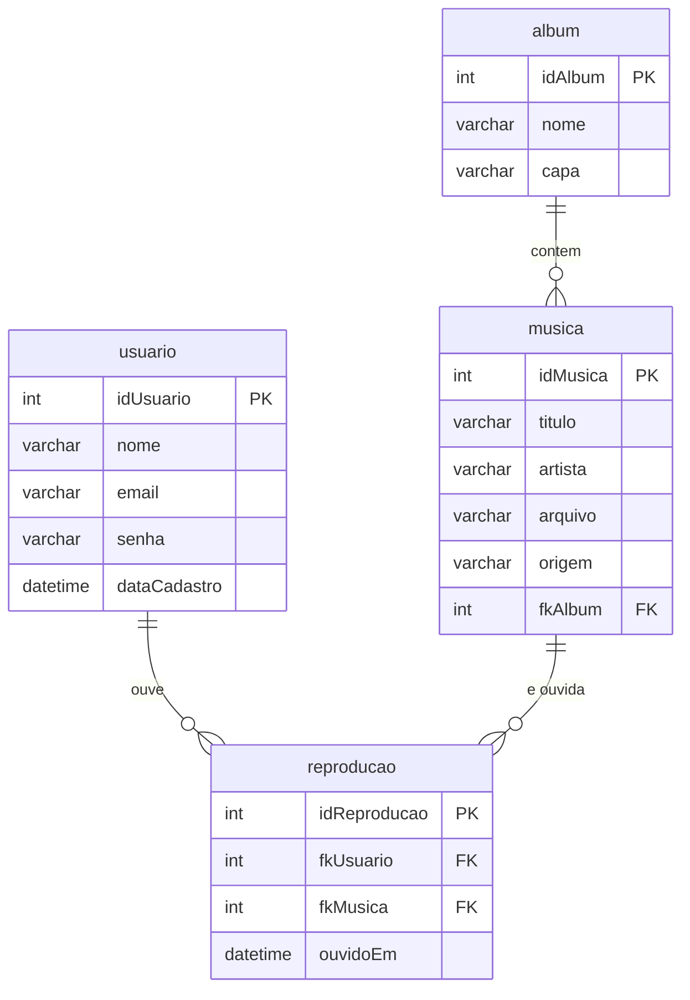
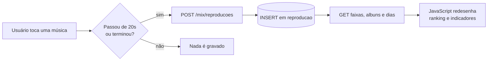

# The-Awesome-Mix
<div align="center">

# THE AWESOME MIX
### Entre estrelas e laços

*Toda música guarda uma lembrança.*

<br>


**Projeto individual · Análise e Desenvolvimento de Sistemas · SPTech**

</div>

---

## Sobre o projeto

**The Awesome Mix** é uma aplicação web que usa o universo de *Guardiões da Galáxia* para contar uma história pessoal: a de quem cria, de quem cuida, dos amigos que viram família e das músicas que carregam lembranças.

O site junta duas coisas:

- **Páginas de conteúdo**, que apresentam a franquia e fazem paralelos entre os personagens e a minha própria vida;
- **Uma área logada, a aba Mix**, onde o usuário ouve as faixas do Awesome Mix do Peter e as minhas favoritas, e acompanha em um **dashboard** o que mais escutou.

---

## Tracklist

| Faixa | Seção |
|:-----:|-------|
| 01 | [Pesquisa e Inovação](#pesquisa-e-inovação) |
| 02 | [1. Contexto](#1-contexto) |
| 03 | [2. Planejamento](#2-planejamento) |
| 04 | [3. Dashboard](#3-dashboard) |
| 05 | [4. Indicadores](#4-indicadores) |
| 06 | [O que tem no site](#o-que-tem-no-site) |
| 07 | [Tecnologias e arquitetura](#tecnologias-e-arquitetura) |
| 08 | [Como executar](#como-executar) |
| 09 | [Próximos passos](#próximos-passos) |

---

## Pesquisa e Inovação

Esta seção reúne os quatro entregáveis do projeto: **Contexto**, **Planejamento**, **Dashboard** e **Indicadores**.

**Referência de pesquisa:** o [Last.fm](https://www.last.fm), plataforma que registra cada música ouvida (um *scrobble*) e transforma esses registros em rankings de faixas, álbuns e artistas.

**O que o projeto traz de novo:**

- Um dashboard de reproduções **dentro de uma narrativa pessoal**, e não de uma plataforma genérica;
- O comparativo **"Peter vs. minhas"**, que cruza as músicas do filme com as músicas da minha história;
- Uma regra de contagem mais fiel ao que a pessoa realmente ouviu: a reprodução só vale **após 20 segundos** de música ou quando ela termina.

---

## 1. Contexto

### Por que Guardiões da Galáxia?

Escolhi a franquia porque o que mais me marca nela não são as batalhas, e sim as relações: pessoas diferentes que se encontram, se apoiam e passam a formar uma família. É uma história sobre **pertencimento, afeto e amizade**.

### Os três eixos da história

| Eixo | No filme | Na minha história |
|------|----------|-------------------|
| **Família** | Yondu, e não Ego, foi quem criou Peter. A frase *"Ele pode ter sido seu verdadeiro pai, mas ele não te criou"* resume a ideia de que família é quem cuida e ensina. | Minha mãe foi a principal referência de criação, cuidado e apoio. |
| **Amizade** | Os Guardiões discutem e são muito diferentes, mas continuam juntos. | Meu grupo de amigos: a amizade não depende de pensar igual, e sim do que construímos juntos. |
| **Música** | O *Awesome Mix* é a fita que liga Peter à mãe e às suas origens. | Parte dos meus gostos musicais vem da convivência com minha mãe. |

### Problema e proposta

- **Oportunidade:** transformar um projeto técnico em algo com significado pessoal, mostrando que a tecnologia também serve para expressar quem somos.
- **Proposta:** uma aplicação web que apresenta a franquia, estabelece paralelos com a minha vida e permite ouvir um *mix* com um dashboard de acompanhamento.
- **Público:** fãs da franquia, colegas e professores, e qualquer pessoa que queira conhecer a história por trás do projeto.

---

## 2. Planejamento

### Meta SMART

> Até **27/11**, concluir o projeto individual *The Awesome Mix*, com login e cadastro, aba Mix com reprodução de músicas e dashboard de reproduções, cumprindo 4 etapas com commits no GitHub a cada etapa e obtendo nota 4 ou mais (de 1 a 5) em facilidade de uso e visual em um teste com uma pessoa.

| Letra | Definição |
|:-----:|-----------|
| **S** · Específica | Entregar um site com Início, Curiosidades, Mix, Login, Cadastro e Dashboard, dividido em etapas pequenas. |
| **M** · Mensurável | 4 etapas concluídas, pelo menos 1 commit por etapa e nota 4 ou mais no teste de uso. |
| **A** · Atingível | Base visual já pronta, ferramentas gratuitas e de 40 a 60 minutos de trabalho por dia. |
| **R** · Relevante | Reúne front-end, back-end, banco de dados, APIs e versionamento, que são a base da carreira. |
| **T** · Temporal | De 07/11 a 27/11, com cronograma por etapa. |

### Cronograma

| Etapa | Período | Entrega | Status |
|:-----:|---------|---------|:------:|
| 1 | 07 a 10/11 | Banco de dados e servidor Node conectado ao MySQL | ✅ |
| 2 | 11 a 15/11 | Cadastro e login funcionando | ✅ |
| 3 | 16 a 21/11 | Aba Mix, player e registro de reproduções | ✅ |
| 4 | 22 a 25/11 | Dashboard, ajustes visuais e teste com uma pessoa | 🔄 |
| Final | 26 a 27/11 | Correções finais e entrega | ⏳ |

### Requisitos funcionais

| Código | Requisito |
|:------:|-----------|
| RF01 | O usuário pode se cadastrar informando nome, e-mail e senha. |
| RF02 | O usuário pode fazer login e é levado à aba Mix. |
| RF03 | A aba Mix exige login; sem ele, a pessoa é enviada de volta ao login. |
| RF04 | O usuário pode ouvir as músicas, com play, pausa e barra de progresso. |
| RF05 | Cada reprodução válida é registrada no banco, ligada ao usuário e à música. |
| RF06 | O usuário pode filtrar por *Todas*, *Awesome Mix do Peter* e *Minhas favoritas*. |
| RF07 | O usuário pode ver o ranking por **faixas** e por **álbuns**. |
| RF08 | O dashboard mostra os indicadores de reprodução do usuário logado. |

### Modelagem do banco de dados



A relação entre **usuário** e **música** é N:N: um usuário ouve várias músicas e uma música é ouvida por vários usuários. A tabela `reproducao` resolve essa relação e tem id próprio e data/hora, porque cada vez que uma música é ouvida gera uma **nova linha**. Já **álbum** e **música** têm relação 1:N: um álbum tem várias músicas e cada música pertence a um álbum.

<details>
<summary><b>Script de criação das tabelas</b></summary>

```sql
create database if not exists mixtape;
use mixtape;

create table usuario (
    idUsuario int primary key auto_increment,
    nome varchar(45),
    email varchar(45) unique,
    senha varchar(45),
    dataCadastro datetime default current_timestamp
);

create table album (
    idAlbum int auto_increment primary key,
    nome varchar(50) not null,
    capa varchar(255) not null
);

create table musica (
    idMusica int auto_increment primary key,
    titulo varchar(45) not null,
    artista varchar(45) not null,
    arquivo varchar(255) not null,
    origem varchar(45) not null,
    fkAlbum int,
    constraint fkMusicaAlbum foreign key (fkAlbum) references album(idAlbum),
    constraint chkOrigem check (origem in ('Guilherme', 'Peter'))
);

create table reproducao (
    idReproducao int auto_increment primary key,
    fkUsuario int not null,
    fkMusica int not null,
    ouvidoEm datetime default current_timestamp,
    foreign key (fkUsuario) references usuario(idUsuario),
    foreign key (fkMusica) references musica(idMusica)
);
```

</details>

### Identidade visual

O visual vem da arte do jogo e do clima espacial do filme, sobre um fundo escuro.

| Cor | Código | Uso |
|-----|--------|-----|
| Preto | `#07050d` | Fundo principal |
| Preto arroxeado | `#120b1f` | Header, cards e footer |
| Magenta | `#e0245e` | Destaque principal, botões e bordas |
| Violeta | `#7b3fe4` | Gradientes, barras das minhas músicas |
| Azul elétrico | `#3d5afe` | Brilhos e gráficos |
| Verde neon | `#a3f23a` | Detalhes pontuais |
| Dourado | `#de9422` | Menu e subtítulos, na cor do logo |
| Texto | `#efe9f7` | Texto claro |

**Fonte:** Rajdhani (Google Fonts), com cara tecnológica e boa leitura nos menus.

---

## 3. Dashboard

O dashboard fica na **aba Mix**, que só abre para quem fez login. Ele tem duas visões, uma página para cada: **Faixas** e **Álbuns**.

### O que o usuário vê

- **Ranking** com posição, capa, título, artista e uma **barra proporcional** ao número de reproduções. As barras do Awesome Mix do Peter são magenta e as das minhas favoritas são violeta;
- **Filtros** por origem das músicas;
- **Player fixo** na parte de baixo da tela, na aba Faixas;
- **Cards laterais** com os indicadores, alinhados à primeira linha do ranking.

| Aba | Cards do painel lateral |
|-----|-------------------------|
| **Faixas** | Música mais ouvida · Peter vs. minhas · Reproduções nos últimos 7 dias |
| **Álbuns** | Álbum mais ouvido · Peter vs. minhas |

### Como os dados chegam ao dashboard



**Regra de contagem:** a reprodução só entra no banco depois de **20 segundos** tocando, ou quando a música acaba (para faixas curtas). Uma trava evita gravar duas vezes a mesma reprodução. Assim, quem clica e pula uma música não infla o dashboard.

### API do back-end

| Método | Rota | Função |
|:------:|------|--------|
| `POST` | `/usuarios/cadastrar` | Cria um novo usuário |
| `POST` | `/usuarios/autenticar` | Faz o login e devolve os dados do usuário |
| `GET` | `/mix/faixas/:idUsuario` | Lista as músicas com o total ouvido pelo usuário |
| `GET` | `/mix/albuns/:idUsuario` | Lista os álbuns com o total ouvido pelo usuário |
| `GET` | `/mix/dias/:idUsuario` | Reproduções por dia nos últimos 7 dias |
| `POST` | `/mix/reproducoes` | Registra uma reprodução |

O back-end segue o padrão **rota → controller → model → banco**: a rota recebe o pedido, o controller valida os dados, e o model monta e executa o SQL.

### Capturas de tela

| Início | Curiosidades |
|:------:|:------------:|
|  |  |

| Login | Cadastro |
|:-----:|:--------:|
|  |  |

| Mix · Faixas |
|:------------:|
| 

---

## 4. Indicadores

### Indicadores do dashboard

| Indicador | O que mede | Como é calculado | Onde aparece |
|-----------|------------|------------------|--------------|
| **Total de reproduções** | Quantas vezes o usuário ouviu músicas, respeitando o filtro escolhido | Soma dos totais da lista exibida | Título da lista |
| **Música mais ouvida** | A faixa com mais reproduções do usuário | `count` por música, ordenado do maior para o menor, e pega o primeiro | Card, aba Faixas |
| **Álbum mais ouvido** | O álbum com mais reproduções do usuário | `count` agrupado por álbum, ordenado do maior para o menor, e pega o primeiro | Card, aba Álbuns |
| **Peter vs. minhas** | Divisão das reproduções entre o Awesome Mix do Peter e as minhas favoritas | Soma dos totais por `origem`, em ângulos de 360° | Gráfico de rosca |
| **Reproduções nos últimos 7 dias** | Constância de uso ao longo da semana | `count` agrupado por dia, de hoje até 6 dias atrás | Gráfico de barras |
| **Posição no ranking** | Quanto cada faixa ou álbum pesa em relação ao mais ouvido | `total ÷ maior total × 100`, usado como largura da barra | Barras da lista |

### Consulta que alimenta o ranking

```sql
select m.idMusica, m.titulo, m.artista, m.arquivo, m.origem,
       a.nome as album, a.capa,
       count(r.idReproducao) as total
from musica m
join album a on a.idAlbum = m.fkAlbum
left join reproducao r on r.fkMusica = m.idMusica and r.fkUsuario = ?
group by m.idMusica, a.idAlbum
order by total desc, m.titulo;
```

O `left join` mantém na lista as músicas que o usuário **ainda não ouviu**, com total 0, e o `count(r.idReproducao)` conta só as reproduções que existem.

### Indicadores de sucesso do projeto

| Indicador | Meta | Situação |
|-----------|------|:--------:|
| Etapas concluídas | 4 de 4 | 🔄 |
| Commits no GitHub | Pelo menos 1 por etapa | ✅ |
| Contagem de progresso aos amigos | Após as etapas 2 e 4 | 🔄 |
| Nota de facilidade de uso e visual | 4 ou mais, de 1 a 5, no teste com uma pessoa | ⏳ |
| Entrega | 27/11 | ⏳ |

---

## O que tem no site

### Páginas

| Página | Arquivo | Conteúdo |
|--------|---------|----------|
| **Início** | `home.html` | Hero com chamada para o projeto e cinco seções com fotos em formato de polaroid inclinada: *Sobre o projeto*, *Yondu e Peter: o significado de família*, *A influência da minha mãe*, *Os Guardiões e a amizade* e *A música como conexão*. |
| **Curiosidades** | `curiosidades.html` | Um card para cada personagem, com título e curiosidades: Peter Quill, Gamora, Drax, Rocket, Groot, Mantis, Nebula, Yondu, Kraglin, Cosmo e Adam Warlock. |
| **Login** | `login.html` | Formulário de acesso, com validação dos campos e mensagem de erro. |
| **Cadastro** | `cadastro.html` | Criação de conta com nome, e-mail, senha e confirmação, com validações. |
| **Mix · Faixas** | `mix.html` | Ranking de faixas com player, filtros e indicadores. |
| **Mix · Álbuns** | `mix-albuns.html` | Ranking de álbuns com filtros e indicadores. |

### Recursos

- Layout em **zigue-zague** com fotos de polaroid inclinadas, que se endireitam ao passar o mouse;
- **Menu e rodapé** comuns a todas as páginas, com links para GitHub, Instagram, LinkedIn e e-mail;
- **Biblioteca de 15 músicas**: 9 do Awesome Mix do Peter e 6 das minhas favoritas, cada uma ligada ao seu álbum;
- **Login com sessão no navegador**, e a aba Mix só abre para quem entrou;
- **Dashboard individual**: cada usuário vê apenas as próprias reproduções;
- **Layout responsivo**, com a coluna única no celular.

---

## Tecnologias e arquitetura

| Camada | Tecnologia |
|--------|------------|
| Front-end | HTML5, CSS3 e JavaScript puro |
| Back-end | Node.js com Express |
| Banco de dados | MySQL |
| Ícones e fontes | Font Awesome e Google Fonts (Rajdhani) |
| Versionamento | Git e GitHub |

### Estrutura de pastas

```
Entre-estrelas-e-lacos/
├── app.js
├── package.json
├── DOCUMENTOS_DE_APOIO/
├── public/
│   ├── assets/
│   │   ├── audio/
│   │   │   ├── guilherme/
│   │   │   └── peter/
│   │   └── img/
│   │       └── capas/
│   ├── css/
│   ├── js/
│   ├── home.html
│   ├── curiosidades.html
│   ├── login.html
│   ├── cadastro.html
│   ├── mix.html
│   └── mix-albuns.html
└── src/
    ├── database/
    ├── usuarios.js
    ├── usuarioController.js
    ├── usuarioModel.js
    ├── mix.js
    ├── mixController.js
    └── mixModel.js
```

---

## Como executar

**Pré-requisitos:** Node.js e MySQL instalados.

**1. Clone o repositório e instale as dependências**

```bash
git clone https://github.com/guisyntax/Entre-estrelas-e-lacos.git
cd Entre-estrelas-e-lacos
npm install
```

**2. Crie o banco de dados**

Rode o script de criação das tabelas (na seção [Modelagem do banco de dados](#modelagem-do-banco-de-dados)) e, em seguida, o script de carga com os álbuns e as músicas. A ordem importa: a tabela `album` precisa existir antes da `musica`, e os álbuns precisam ser inseridos antes das músicas.

**3. Configure a conexão**

Ajuste o usuário, a senha e o nome do banco (`mixtape`) no arquivo de configuração dentro de `src/database`.

**4. Coloque os arquivos de mídia**

- Áudios em `public/assets/audio/peter/` e `public/assets/audio/guilherme/`;
- Capas dos álbuns em `public/assets/img/capas/`.

Os nomes dos arquivos precisam ser iguais aos caminhos gravados no banco.

**5. Inicie o servidor**

```bash
npm start
```

Acesse **http://localhost:3333**.

## Autor

**Guilherme Sousa Pinheiro**
Análise e Desenvolvimento de Sistemas · SPTech

[](https://github.com/guisyntax)
[](https://linkedin.com/in/guilherme-sousa-pinheiro-1ba516299)
[](mailto:guilherme.spinheiro@sptech.school)

## Aviso

Projeto de fins exclusivamente acadêmicos e sem fins lucrativos. *Guardiões da Galáxia*, seus personagens e imagens são © Marvel. As músicas e as capas de álbum pertencem aos seus respectivos artistas e gravadoras.

<div align="center">

**Feito com ♥**

</div>
